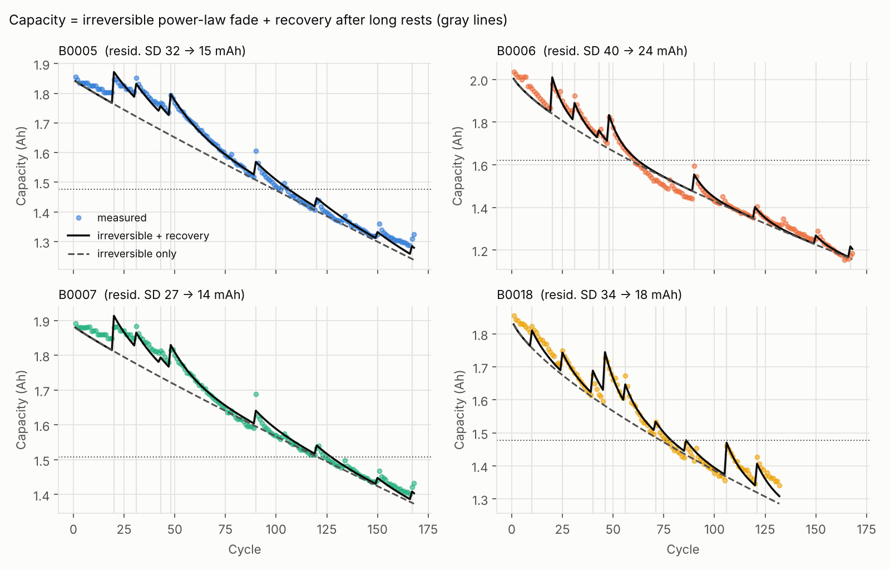
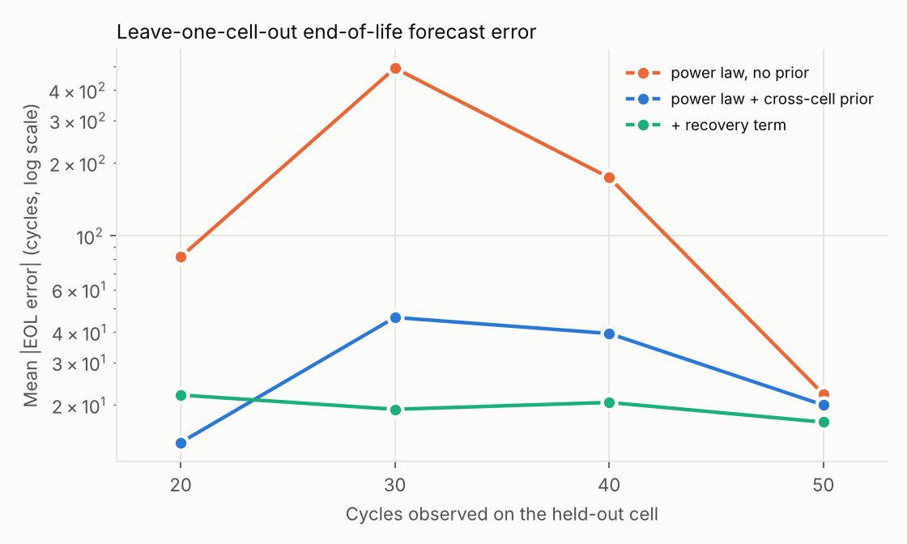
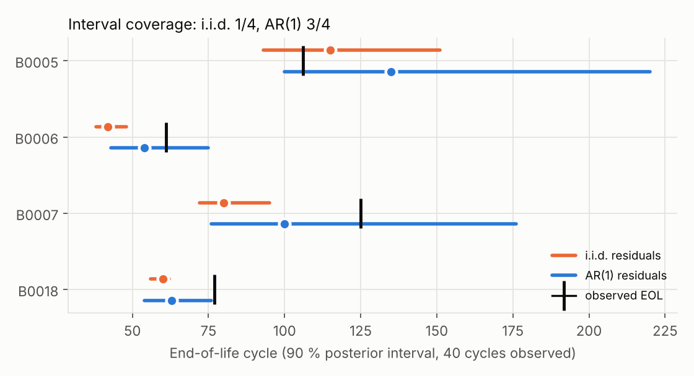

# Cell lifetime model with capacity recovery: NASA 18650 aging data

Calibrating and forecasting Li-ion capacity fade from cycling test data, with
end-of-life (EOL) uncertainty that is checked against what actually happened.

**Data.** NASA Prognostics Center of Excellence Li-ion aging set (Saha & Goebel, 2007):
cells B0005, B0006, B0007, B0018, 18650 format, 24 °C, CC-CV charge to 4.2 V, 2 A CC
discharge. 636 discharge cycles in total, 24–41 % capacity fade. EOL is defined as the
first cycle where a 5-cycle running median of measured capacity falls below 80 % of
initial capacity (cycles 61–125 across the four cells).

The NASA set also contains 4 °C and 43 °C groups. They were run with different discharge
currents and cut-off voltages, so a cross-temperature (Arrhenius) fit on them would
confound temperature with protocol. They are left out on purpose.

## Model

Measured capacity is split into an irreversible part and a recoverable part:

```
Q(n) = q0 · (1 − a·n^z)                                         irreversible fade
     + Σ_j  g · (1 − exp(−t_rest,j / τ)) · exp(−(n − n_j) / λ)   recovery after rest j (t_rest > 12 h)
```

The second term encodes a mechanism visible in the data: after a long rest the cell
delivers more capacity, and the excess decays over the following cycles. The
mechanism is commonly attributed to lithium redistribution, such as relaxation of
concentration gradients and lithium returning from overhang regions. The rest times
come straight from the test timestamps.

## Results

| | Result |
|---|---|
| Recovery is real | 33 rests longer than 12 h; capacity rises 50 mAh on average on the next cycle, vs −6.7 mAh after routine rests (Spearman ρ = 0.34 between rest length and capacity change, p < 1e-18) |
| Recovery term | Residual SD drops from 33 to 18 mAh (mean over cells). Fitted parameters agree across cells: τ = 50–66 h, λ = 7–18 cycles, g = 103–172 mAh |
| Fade-law choice | With 40 cycles observed, power law, √n + linear and double exponential all miss EOL by 133–174 cycles on average. The functional form is not the bottleneck. |
| Leave-one-cell-out | Priors learned from 3 cells, forecast the 4th from its first k cycles (table below) |
| Uncertainty | Bayesian posterior (emcee) at k = 40. With i.i.d. residuals, the 90 % EOL interval contains the observed EOL for 1 of 4 cells. With AR(1) residuals (fitted φ = 0.63–0.88), it does for 3 of 4. |

Mean absolute EOL error (cycles) across the four held-out cells:

| cycles observed (k) | power law, no prior | + cross-cell prior | + prior and recovery term |
|---|---|---|---|
| 20 | 81.8 | **14.0** | 22.0 |
| 30 | 492.7 | 46.0 | **19.2** |
| 40 | 174.0 | 39.5 | **20.5** |
| 50 | 22.2 | 20.0 | **17.0** |

At k = 20 the recovery model is worse: no long rest has happened yet in most cells, so
its extra parameters are carried by the prior alone. From k = 30 onward it is the
most accurate and the most stable of the three.





## Limitations

- Four cells from one protocol. The cross-cell prior is thin, so its covariance is
  inflated ×4 with a floor; results with more cells could differ.
- One temperature and one discharge rate, so the model has no stress-factor
  dependence. It is a single-protocol lifetime model, not a field-usage model.
- The forecast assumes no future long rests; the EOL target is measured capacity,
  so future recovery events can delay the observed EOL.
- B0018 is still missed by the AR(1) interval (upper bound 76, observed 77).

## Reproduce

```bash
pip install -r requirements.txt
python scripts/get_data.py          # downloads the NASA .mat files into data/raw/
python src/extract.py               # -> data/capacity.csv
python src/lifetime.py              # -> results/metrics.json (about 1.5 min)
python src/figures.py               # -> figures/*.png
```

`data/capacity.csv` (per-cycle capacity, rest time, temperature) is committed, so
`lifetime.py` and `figures.py` run without the raw download.

## Reference

B. Saha and K. Goebel (2007). *Battery Data Set*, NASA Prognostics Data Repository,
NASA Ames Research Center, Moffett Field, CA.

---

## Production layer (branch `mlops-production`)

The research model above, turned into a service that can be retrained, gated and
monitored. Everything below was run end to end; numbers are in `results/`.

```
data_check ─► tune_evaluate_register ─► shift_check ─► [if promoted] release_note     (Kubeflow, KFP v2)
                    │  Optuna, nested LOCO
                    ▼
              MLflow tracking + model registry  (aliases: champion / challenger)
                    │
                    ▼
     FastAPI service ─ /v1/forecast ─ decision + 90 % interval + reason codes
        ├─ envelope gates: route out-of-range inputs to an engineer
        ├─ shadow model scored after the response, logged for comparison
        └─ Prometheus /metrics, JSONL request log for drift checks
```

| Piece | File | What it does |
|---|---|---|
| Forecaster | `mlops/core.py` | Cross-cell prior + MAP fit + Laplace/AR(1) interval; analytic EOL; input validation and abstain rules |
| Tuning, registry | `mlops/train.py` | Optuna over prior inflation, recovery-rest threshold, noise and interval scale; objective is the 90 % interval score; nested leave-one-cell-out for an honest estimate; logs to MLflow and promotes only if the nested score beats the current champion |
| Pipeline | `pipelines/kfp_pipeline.py` | KFP v2 DAG; compiles to `pipelines/cell_eol_pipeline.yaml`; runs locally with the KFP subprocess runner |
| Service | `serve/app.py` | FastAPI + pydantic schema, model loaded from the registry by alias, background shadow scoring, Prometheus metrics |
| Shift check | `mlops/monitor.py` | Replays NASA cells run under other protocols (`scripts/get_shift_data.py`) |
| Load test | `mlops/bench.py` | Starts uvicorn and replays 2,000 real cell histories |
| CI | `.github/workflows/ci.yml` | Tests, pipeline compile, smoke train/register, shift gate |

### Evaluation (nested leave-one-cell-out, k = 30/40/50 cycles, 12 forecasts)

| | EOL MAE (cycles) | 90 % interval score | mean interval width | 90 % coverage |
|---|---|---|---|---|
| Fleet-mean EOL baseline | 31.0 | – | – | – |
| Research configuration (untuned) | 19.9 | 141.4 | 128 | 10/12 |
| Tuned, v1 (narrower search space) | 15.3 | 106.6 | 100 | 10/12 |
| **Tuned, v2 (champion)** | **12.7** | **66.1** | **35** | **9/12** |

Hyperparameters are tuned on three cells and scored once on the fourth, so these
numbers never touch the tuned-on data. The champion's intervals are much
narrower but under-cover: 9/12 against a nominal 90 %. Twelve forecasts from four
cells cannot pin coverage down, and more cells are the fix, not more tuning.

While porting, one leak was found and removed: the research script estimated the
residual noise from all four cells, including the held-out one. The production
model uses training cells only (the effect on LOCO error was under one cycle).

### Registry gate

| Event | Result |
|---|---|
| v1 trained | promoted (no champion yet) |
| v2 trained with a wider search space | promoted (nested interval score 66.1 < 106.6) |
| v3 identical retrain via the Kubeflow pipeline | **not** promoted (no improvement), champion stays v2 |

### Distribution shift (`results/drift_report.json`)

Five NASA cells the model never saw, run at 43 °C, 4 °C or a 4 A discharge, were
replayed at 40 cycles: 5/5 routed to an engineer or rejected (temperature and
initial-capacity envelope, capacity jumps, zero-capacity records). Control: each
training cell, scored by a model fit on the other three, gets a forecast (4/4).

Per-cycle PSI was tried as a drift gate and dropped. With four training cells,
between-cell spread dominates, and in-distribution held-out cells also exceed the
0.25 alert. PSI is still logged as a diagnostic.

### Latency (`results/latency_benchmark_*.json`)

2,000 requests of 10–120 real cycles each; uvicorn, 1 worker, 2 vCPU, with the load
generator on the same machine, so these are upper bounds.

| Configuration | sequential p50 / p95 | 16 concurrent p95 | throughput (16 conc.) | errors |
|---|---|---|---|---|
| Champion only | 6.5 / 15.4 ms | 0.41 s | 87 req/s | 0 |
| + shadow, scored inline | 9.8 / 55.9 ms | 1.87 s | 39 req/s | 0 |
| + shadow, scored in background | 16.3 / 48.2 ms | 0.83 s | 41 req/s | 0 |

The model itself takes about 3 ms per request (p99 14 ms in-process). Under load
the service is CPU-bound, and a shadow model costs about half the capacity, so
shadow mode is meant for a validation window, not for permanent use on this
footprint.

### Not done here

- No Kubernetes cluster: the pipeline was compiled and run with the KFP local
  runner (all four steps), not on Kubeflow itself.
- No Docker daemon: the `Dockerfile` has not been built.
- Ground-truth feedback (joining logged forecasts to observed EOL) is designed
  into the request log but not implemented.

### Run it

Full deployment guide: [DEPLOY.md](DEPLOY.md). One-command local stack
(`docker compose up --build`: MLflow, the Kubeflow pipeline, the API and a demo
page with 22 test cases), a public Hugging Face Space, and Kubernetes manifests.

```bash
pip install -e ".[mlops,serve,dev]"
python scripts/get_shift_data.py        # shift-test cells (not used for training)
make test train monitor pipeline-local
make serve                               # http://localhost:8000/docs
make bench
make ui                                  # MLflow UI
```
