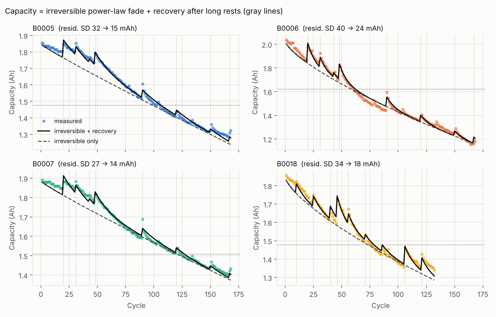
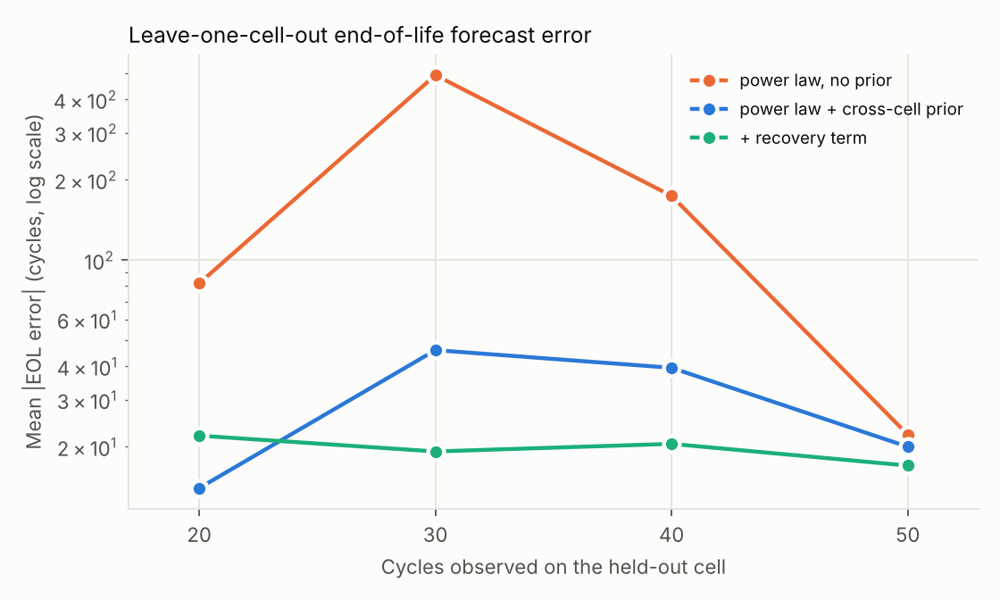
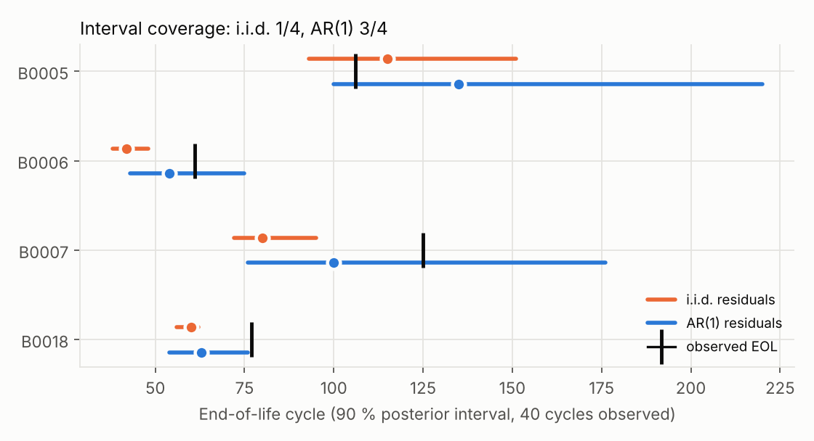

# Cell lifetime model with capacity recovery: NASA 18650 aging data

Calibrating and forecasting Li-ion capacity fade from cycling test data, with
end-of-life (EOL) uncertainty that is checked against what actually happened.

**Data.** NASA Prognostics Center of Excellence Li-ion aging set (Saha & Goebel, 2007):
cells B0005, B0006, B0007, B0018, 18650 format, 24 °C, CC-CV charge to 4.2 V, 2 A CC
discharge. 636 discharge cycles in total, 24–41 % capacity fade. EOL is defined as the
first cycle where a 5-cycle running median of measured capacity falls below 80 % of
initial capacity (cycles 61–125 across the four cells).

The NASA set also contains 4 °C and 43 °C groups. They were run with different discharge
currents and cut-off voltages, so a cross-temperature (Arrhenius) fit on them would
confound temperature with protocol. They are left out on purpose.

## Model

Measured capacity is split into an irreversible part and a recoverable part:

```
Q(n) = q0 · (1 − a·n^z)                                         irreversible fade
     + Σ_j  g · (1 − exp(−t_rest,j / τ)) · exp(−(n − n_j) / λ)   recovery after rest j (t_rest > 12 h)
```

The second term encodes a mechanism visible in the data: after a long rest the cell
delivers more capacity, and the excess decays over the following cycles. The
mechanism is commonly attributed to lithium redistribution, such as relaxation of
concentration gradients and lithium returning from overhang regions. The rest times
come straight from the test timestamps.

## Results

| | Result |
|---|---|
| Recovery is real | 33 rests longer than 12 h; capacity rises 50 mAh on average on the next cycle, vs −6.7 mAh after routine rests (Spearman ρ = 0.34 between rest length and capacity change, p < 1e-18) |
| Recovery term | Residual SD drops from 33 to 18 mAh (mean over cells). Fitted parameters agree across cells: τ = 50–66 h, λ = 7–18 cycles, g = 103–172 mAh |
| Fade-law choice | With 40 cycles observed, power law, √n + linear and double exponential all miss EOL by 133–174 cycles on average. The functional form is not the bottleneck. |
| Leave-one-cell-out | Priors learned from 3 cells, forecast the 4th from its first k cycles (table below) |
| Uncertainty | Bayesian posterior (emcee) at k = 40. With i.i.d. residuals, the 90 % EOL interval contains the observed EOL for 1 of 4 cells. With AR(1) residuals (fitted φ = 0.63–0.88), it does for 3 of 4. |

Mean absolute EOL error (cycles) across the four held-out cells:

| cycles observed (k) | power law, no prior | + cross-cell prior | + prior and recovery term |
|---|---|---|---|
| 20 | 81.8 | **14.0** | 22.0 |
| 30 | 492.7 | 46.0 | **19.2** |
| 40 | 174.0 | 39.5 | **20.5** |
| 50 | 22.2 | 20.0 | **17.0** |

At k = 20 the recovery model is worse: no long rest has happened yet in most cells, so
its extra parameters are carried by the prior alone. From k = 30 onward it is the
most accurate and the most stable of the three.





## Limitations

- Four cells from one protocol. The cross-cell prior is thin, so its covariance is
  inflated ×4 with a floor; results with more cells could differ.
- One temperature and one discharge rate, so the model has no stress-factor
  dependence. It is a single-protocol lifetime model, not a field-usage model.
- The forecast assumes no future long rests; the EOL target is measured capacity,
  so future recovery events can delay the observed EOL.
- B0018 is still missed by the AR(1) interval (upper bound 76, observed 77).

## Reproduce

```bash
pip install -r requirements.txt
python scripts/get_data.py          # downloads the NASA .mat files into data/raw/
python src/extract.py               # -> data/capacity.csv
python src/lifetime.py              # -> results/metrics.json (about 1.5 min)
python src/figures.py               # -> figures/*.png
```

`data/capacity.csv` (per-cycle capacity, rest time, temperature) is committed, so
`lifetime.py` and `figures.py` run without the raw download.

## Reference

B. Saha and K. Goebel (2007). *Battery Data Set*, NASA Prognostics Data Repository,
NASA Ames Research Center, Moffett Field, CA.
